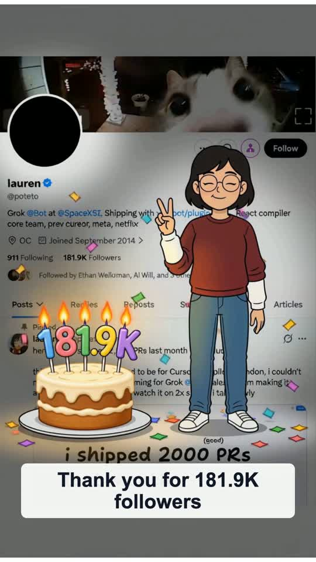

# Lauren V6 公开示例

[English](README.md) · **中文**

选用 2026 年 10 月 12 日生成的最后一版 Lauren V6：**15.125 秒、1080×1920、24 fps、带音轨**。来源档案为 lauren（`@poteto`），**181.9K Followers**。

[](video.mp4)

[下载 / 查看视频](video.mp4) · [输入截图](screenshot.png) · [角色参考图](character.png) · [档案](profile.json)

## 媒体授权

这些媒体**仅允许本仓库展示和下载**，保留原版权，**不适用 MIT**。不授予商用、修改、再发布、再分发或另行托管的权利。维护者声明的范围见 [MEDIA_LICENSE.txt](MEDIA_LICENSE.txt)。代码许可与 `rightsConfirmed` 不扩大媒体权利，也不表示有关人士背书。

## 复现配置

按[主说明](../../README.zh-CN.md)克隆、安装依赖、配置 `FAL_KEY` 后，在仓库根目录运行：

```bash
npm run dev -- generate \
  --profile examples/lauren/profile.json \
  --screenshot examples/lauren/screenshot.png \
  --character examples/lauren/character.png \
  --provider minimax-h3-max \
  --locale en \
  --platform twitter \
  --prompt-file examples/peace-sign-v6.zh-CN.txt \
  --max-attempts 1 \
  --max-estimated-cost-usd 1.50 \
  --out runs/lauren-v6-reproduction
```

命令会将截图和角色参考图上传到 fal，提交**一次新的付费视频请求**。已知估算 US$1.20，参考用量可能另计，实际账单未知。复用参考图，不再生成角色。上面的展示和下载授权不自动授予生成新衍生作品的权利；运行命令应另有相应媒体许可。

本示例使用**中文 V6 原始自定义提示词**，收尾字幕为英文 `Thank you for 181.9K followers`。当前内置默认 V6 为英文译本，因此省略 `--prompt-file` 不会使用本次测试的原始配置。模型生成具有随机性，命令复现配置，不能保证逐帧相同。

[generation.json](generation.json)保存冻结的完整提示词、参数、输入输出 SHA-256 和已知限制，不含本地路径、fal 请求 ID、私有服务地址或凭据。视频直接复制所选 V6 成片，未重新编码。

## Alpha 已知缺陷

检查帧中，头像正确留空黑圆、帖子图片保持可见；但页面仍变暗，蛋糕仍有托盘，人物脚下阴影及局部光照仍存在。最后人物闭眼，也可能出现轻微 UI 和文字漂移。示例保留这些局限，`completed` 仅表示导出完成，不代表质量通过。
